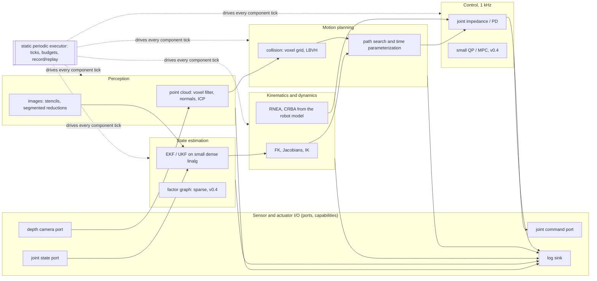
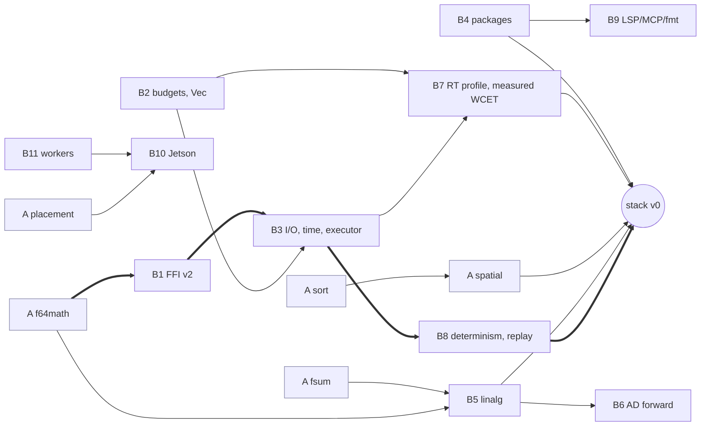

# Invar v0.2 to v1.0: a robotics stack written only in Invar

Status: architecture decision record for the v0.2 program, written on 18 October 2026 against `origin/main` at `85d38988`.
The Phase A workstream scopes are final decisions and are restated here, not changed.
Every Phase B item below is a decision with one pick; rejected options are listed so nobody reopens them without new evidence.
Conflicts between Phase A workstreams are listed in section 4.3, and the rulings on them are in section 4.4.
Section 4.5 records what the workstreams implemented where it differs.

## 1. The target

The target robotics stack (perception, state estimation, kinematics and dynamics, control, planning, sensor and actuator I/O, and the real-time loop) is written in Invar and nothing else.
Foreign code remains only where it is the plant or the transport: the simulator (MuJoCo), the robot's fieldbus driver, and ROS 2 when a product needs ROS interop.
Every Invar component keeps the language's core promises on every engine: defined traps with first-trap-in-source-order, no implicit reassociation, and bit-identical results across `reference`, `native-serial`, `cpu-parallel`, `cuda` and `metal` (Metal refuses f64 and runs it on the CPU, so results stay identical).

### 1.1 Reference architecture



Every box is an Invar `component` from the existing system dialect (`spec/grammar.ebnf` lines 8-38, `docs/system-integration-v1.md` section 1) whose implementation is `impl invar ...`.
Today `impl invar` is recorded in the IR and used only for the license link class (`src/system.rs:812-828`, `src/system/graph.rs:726`); no runtime executes an Invar component.
Making that line real is the core of v0.2.

### 1.2 What each subsystem needs from the language

| Subsystem | Typical kernels | Language features required | Where it comes from |
| --- | --- | --- | --- |
| Perception: point clouds | voxel downsample, kNN normals, ICP, RANSAC planes | f32 arrays above 1M elements, sort, neighbour queries, 3x3 SVD, deterministic RNG | A-sort, A-spatial, B2, B5, C-rng |
| Perception: images | rectification, filtering, depth to points | 2-D stencils, f32 math, large arrays | M4-02 (#2), A-f64math, B2 |
| State estimation | EKF/UKF predict and update, factor graphs | f64, 6x6..18x18 dense solves, Jacobians, sparse Cholesky later | A-f64math, B5, B6, C-sparse |
| Kinematics and dynamics | FK, geometric Jacobian, DLS IK, RNEA, CRBA | f64, correctly rounded trig, SE3/quaternions, robot model as input | A-f64math, B5, R1-02 (#16) |
| Control | PD/impedance at 1 kHz, small MPC | per-tick budgets, no allocation, measured WCET, f64 | B2, B3, B7 |
| Motion planning | collision checks, IK waypoints, time parameterization, RRT later | spatial queries, bounded `Vec<T>`, RNG | A-spatial, B2, C-rng |
| Sensor and actuator I/O | typed ports, monotonic time, logs | capabilities, ports in function signatures, i64 time | B3 |
| Real-time loop | periodic tick, deterministic schedule, replay | executor, step-locked simulation, record/replay | B3, B7, B8 |
| Interop during migration | MuJoCo plant, ROS 2 bridge, C libraries | f64 arrays and C-layout records across the C ABI, exports | B1 |
| Codebase scale | tens of thousands of lines, many files | multi-file modules, packages, no 128-function cap | B4 |
| Authoring | editors and coding agents | LSP, MCP, formatter | B9 |

## 2. Gap analysis against main `85d38988`

| Capability | State on main (cited) | Gap for the stack | Closed by |
| --- | --- | --- | --- |
| Executable types | `i32`, `u32`, `Bool`, `f32` and `Array<f32>` execute (`docs/m4-source.md` lines 3-12); `f64` and `i64` are type-only (`spec/grammar.ebnf:164`, `src/check.rs:189`) | No f64 kinematics, no i64 nanosecond time | A-f64math, B3 (i64) |
| Math library | `fma`, `f32_from_i32`, `f32_from_u32`, `filled_f32` only (`src/check.rs:91-111`); trig is in the open P0a work (`invar-trig-f32-v1`), not on main | No sin/cos/atan2/sqrt on main; no float-to-int conversion at all | A-f64math |
| Float reductions | A source `for` fold stays in source order; no parallel float sum | Point clouds and dot products need deterministic parallel sums | A-fsum |
| Sort, neighbours | None | Voxel grids, kNN, broadphase | A-sort, A-spatial |
| Placement | CPU default before calibration freeze; family-specific routes (spec B.5 in `docs/spec/invar-v0.1.md`; open work in the `docs/remaining-work.md` rows for #49 and #47) | Automatic, calibrated, per machine | A-placement |
| Array size | 1,000,000 elements per array (`src/eval.rs:20`, `src/mir_eval.rs:27`, `src/native_host.rs:9`); 2,000,000 live elements (`src/eval.rs:23`, `src/native_host.rs:10`) | One 640x480 depth frame as three SoA arrays is 921,600 elements; two frames exceed the live cap | B2 |
| Fuel | Global fuel, default 1,000,000 steps (`src/main.rs:153`, `spec/bootstrap.md` reference execution section) | A 1 kHz controller runs 3.6M ticks per hour | B2 |
| Dynamic containers | Fixed-length arrays only (`spec/bootstrap.md` values section) | Planner output, variable-size neighbour lists | B2 |
| Program size | One file of at most 1 MiB (`src/front.rs:5`); 128 lowered functions (`src/mir.rs:14`, `src/check/generics.rs:5`, `src/check/closures.rs:9`); 16 generic frames (`src/check/generics.rs:6`); lexical modules only (L1-01) | A stack is many files and thousands of functions | B4 |
| I/O | None; `main` returns `i32` and that is the only output (`docs/m4-source.md` line 12) | Sensors, actuators, clocks, logs | B3 |
| Components | `impl invar` parsed and recorded, never executed (`src/system.rs:812-828`) | Components must run | B3 |
| C ABI | v1 tags `i32`, `u32`, `Bytes`, `String` only (`include/invar_foreign_v1.h:8-11`); oracle required; no callbacks (`spec/bootstrap.md` L1-04 section); f64 layouts exist only as a fixed registry for manifests (`src/system/foreign.rs:35-36`) | f64 arrays and records across the boundary, both directions | B1 |
| Linear algebra | Integer-only frame helpers (`src/check/frame_helpers.inv`); `std::robotics` records are wire-only (`lib/std/robotics/vocabulary.inv` line 1) | SE3, quaternions, small solves | B5 |
| Differentiation | None | EKF Jacobians, optimization-based IK and MPC | B6 |
| Real-time | Declared `wcet` and `deadline` clauses only (`spec/grammar.ebnf:33-34`); reports say deadlines are declared, not measured (`docs/system-integration-v1.md` section 6) | Allocation-free, bounded ticks, measured timing | B7 |
| Determinism of the cell | S1-06 repeats differ: 3 distinct final-state hashes per arm (`examples/cells/reach_place/evidence/summary.txt`); cause is clock-scheduled control without a step barrier (`examples/cells/reach_place/evidence/README.md`, repeat section) | Bit-exact repeat and replay | B8 |
| Tooling | CLI only; AI-01 diagnostics and explain schema exist | LSP, MCP, formatter | B9 |
| CPU parallelism | 4 workers (`src/schedule/workers.rs:15`); the open worker-cap change lifts it but its exact-head CI fails in `issue_m2_05` | Use the cores of the host | B11 |
| Embedded target | None; aarch64 Linux CPU qualified for native (`docs/remaining-work.md`, ABI11 section) | Jetson Orin | B10 |

The open issues #1-#10 (M4/M5 qualification), #14 and #15 (bindings, spec reconciliation) and S1-04 and #29 (S1 acceptance) remain v0.1 work and are prerequisites only where section 6 says so.
The future issues this document re-scopes are #11, #13, #17, #18, #20, #21, #22, #23 and #25; their new scope is in section 5 and in the issue bodies.

## 3. Language principles that every v0.2 item follows

1. **Explicit operations, never substitution.** New algorithms (sort, tree sums, neighbour queries, linear solves) are named intrinsics; the compiler never replaces a user's loop with one, and `explain` may only hint.
2. **One CPU oracle per operation.** Every operation has a reference semantics in the reference evaluator; devices match it bit-for-bit or the placement refuses the device.
3. **Traps are values of the source order.** New operations reuse `INTEGER_OVERFLOW`, `DIVISION_BY_ZERO` and `INDEX_OUT_OF_BOUNDS` unless a new category is justified here; B2 adds none.
4. **One NaN class per float type.** Every operation that produces a NaN writes the canonical quiet NaN (`0x7fc00000` for f32, `0x7ff8000000000000` for f64), so bit-identity tests are meaningful.
5. **Capabilities, not ambient authority.** A function touches time, ports, logs or files only through a parameter that the runtime passed it.
6. **Limits are budgets, not constants.** Hard-coded element caps become declared, checked budgets (B2), still enforced as tool errors.
7. **Reuse first.** Each Phase B item records its survey; net-new code is justified against every candidate.

## 4. Phase A: the five workstreams as one surface

### 4.1 Integrated surface

| Operation | Workstream | Element types | Result | Traps | NaN rule |
| --- | --- | --- | --- | --- | --- |
| `sort(mut xs)` | sort | u32, i32, f32 | in place, stable | none | totalOrder after canonicalization; NaN last, input order kept |
| `sort_by_key(mut keys, mut values)` | sort | keys u32/i32/f32, values any scalar | in place, stable | length mismatch `INDEX_OUT_OF_BOUNDS` | as `sort` |
| `argsort(read xs) -> Array<u32>` | sort | u32, i32, f32 | fresh owner | none | as `sort` |
| `segmented_sort(mut xs, read offsets)` | sort | u32, i32, f32 | in place | bad offset `INDEX_OUT_OF_BOUNDS` at the first bad offset | as `sort` |
| `sum_tree(read xs) -> T` | fsum | f32, then f64 | scalar | none | any NaN gives canonical NaN; +inf with -inf gives NaN |
| `dot_tree(read a, read b) -> T` | fsum | f32, then f64 | scalar | length mismatch `INDEX_OUT_OF_BOUNDS` | as `sum_tree` |
| `sum_exact(read xs) -> T` | fsum | f32, then f64 | correctly rounded | none | as `sum_tree`; exact overflow gives inf |
| `dot_exact(read a, read b) -> T` | fsum | f32, then f64 | correctly rounded | length mismatch `INDEX_OUT_OF_BOUNDS` | as `sum_exact` |
| `f64` everywhere `f32` is | f64math | f64 | | float-to-int `INTEGER_OVERFLOW` on NaN or out of range | one class, `strict-f64-v1` |
| `sin` ... `pow`, `floor` ... `copysign`, `min`, `max` | f64math | f32, f64 | correctly rounded (`invar-math-cr-v1`) | none | NaN in gives canonical NaN; `min`/`max` are minimumNumber/maximumNumber |
| `voxel_grid_build(read xs, ys, zs, cell) -> VoxelGrid` | spatial | f32 | affine opaque `VoxelGrid` (C2) | key overflow or bad cell `INTEGER_OVERFLOW` (C7) | non-finite points excluded (C6) |
| `radius_neighbors(read grid, read qx, qy, qz, radius, max_k) -> Neighbors` | spatial | f32 | record (C1): true counts and CSR indices | length mismatch `INDEX_OUT_OF_BOUNDS`, stride overflow `INTEGER_OVERFLOW` (C9) | non-finite query gives count 0 (C6) |
| `knn(read grid, read qx, qy, qz, k) -> Knn` | spatial | f32 | record (C1): indices and squared distances | as `radius_neighbors` | as `radius_neighbors` |
| `grid_excluded(read grid) -> u32` | spatial | `VoxelGrid` | count of points excluded at build (C6) | none | counts every point with a non-finite coordinate |
| LBVH, `aabb_overlaps`, `raycast_first` | spatial phase 2 | f32 | as above | as above | as above |
| `invar calibrate`, `--engine auto` | placement | all regions | placement only, never results | none | n/a |

### 4.2 Cross-workstream rules that already agree

- Sort's totalOrder puts -0 before +0, and f64math's `min`/`max` (IEEE minimumNumber and maximumNumber) also treat -0 as less than +0, so ordering and extremes agree.
- Spatial squared distances are `dx*dx + dy*dy + dz*dz` left to right with no FMA; for three terms this is the same operation sequence as a left-to-right leaf of `dot_tree` when the leaf block is at least 3, so a later `dot_tree`-based distance would not change bits.
- Every workstream routes through cost-model placement with unknown cost meaning CPU, which is exactly placement's selection rule.
- Placement never changes results, because every workstream's operations are exact or bit-identical by construction.

### 4.3 Conflicts and proposed fixes (no workstream decision is changed here)

| ID | Workstreams | Conflict | Evidence | Proposed fix |
| --- | --- | --- | --- | --- |
| C1 | spatial | `radius_neighbors` and `knn` return tuples, but Invar has no tuple type | `spec/grammar.ebnf:105` lists no tuple; L1-01 has records only | Return built-in records `Neighbors { counts: Array<u32>, idx: Array<u32> }` and `Knn { idx: Array<u32>, d2: Array<f32> }`; callers use the existing `move r.counts` field-move rule (`spec/bootstrap.md` L1-01 section) |
| C2 | spatial | `Grid` is an opaque affine value, but the language has no opaque built-in owner type and parameter modes exist only for arrays | `spec/bootstrap.md` ownership section: "Array parameters require exactly `read`, `mut`, or `take`" | Admit `Grid` (and later `Bvh`) as built-in non-Copy owners with `read` and `take` modes, released by normal cleanup and counted in the live budget (B2) |
| C3 | f64math | The brief says float-to-int conversions match "the f32 rules on main", but main has no float-to-int conversion | `src/check.rs:91-111` has only `f32_from_i32` and `f32_from_u32` | f64math defines `i32_from_f32`, `u32_from_f32`, `i32_from_f64`, `u32_from_f64` (truncation toward zero, `INTEGER_OVERFLOW` on NaN or out of range) for both widths, and the spec names them as new |
| C4 | f64math, P0a | `sin`, `cos` and `sqrt` mean `invar-trig-f32-v1` (up to 2 ULP) in P0a and correctly rounded `invar-math-cr-v1` in v0.2; if P0a lands in v0.1, the same source changes bits in v0.2 | P0a description: "max 2 ULP" | Treat it as a recorded semantic change: MIR and receipts carry the math contract id, v0.1 receipts stay replayable under `trig-f32-v1`, and the v0.2 release notes list it; alternatively hold P0a out of v0.1 |
| C5 | sort, fsum, f64math | Element-type coverage differs: sort is u32/i32/f32, fsum is f32 then f64, spatial is f32 only; sort has no f64 although f64 becomes a full type | workstream briefs | Add f64 (and i64 once B3 lands) to sort as a follow-up issue in the sort workstream; keep spatial f32 |
| C6 | spatial | NaN and infinite coordinates are unspecified: a NaN distance fails every IEEE comparison but sorts last under sort's totalOrder | sort brief (totalOrder), spatial brief (no NaN rule) | Non-finite points are excluded from `Grid` at build time and `grid_excluded(read grid) -> u32` reports how many; queries with a non-finite coordinate return count 0 and empty slots |
| C7 | spatial, f64math | Cell keys need a float-to-int conversion whose op sequence and overflow rule are unspecified | spatial brief | Key is `i32_from_f32(floor(x / cell))` in strict f32 (C3 rule); a finite point whose key overflows traps `INTEGER_OVERFLOW` at the first such point in index order; `cell` that is not finite and positive traps `INTEGER_OVERFLOW` before any point |
| C8 | spatial | Inclusive or exclusive radius, and how `radius*radius` is rounded, are unspecified | spatial brief | Neighbour iff `d2 <= r2` with `r2 = radius * radius` in strict f32; negative or NaN radius gives no neighbours |
| C9 | spatial, sort | Mismatched `xs/ys/zs` or `qx/qy/qz` lengths and `n_queries * max_k` overflow are unspecified | spatial brief | Length mismatch traps `INDEX_OUT_OF_BOUNDS` (as sort and fsum do); a stride product that overflows u32 traps `INTEGER_OVERFLOW`; above the B2 budget it is the usual tool error |
| C10 | sort, M4-04 | The `segmented_sort` offset convention (with or without the final length) is unstated | M4-04 requires `segments + 1` offsets, first 0, last `len`, non-decreasing (`src/segmented_source.rs:396-406`) | Adopt the M4-04 convention exactly, so segmented families and sort share one descriptor |
| C11 | fsum | The sign of zero for empty and singleton sums is unstated, and `sum_exact` of all `-0` is ambiguous | fsum brief | `sum_tree([]) = sum_exact([]) = +0`; a leaf starts from its first element, not from `+0`, so `sum_tree([-0]) = -0`; `sum_exact` returns -0 only when every input is -0, the sign rule of exact addition under roundTiesToEven (IEEE 754-2019 section 6.3) |
| C12 | fsum, B5 | The leaf block (8 in the brief's example) fixes small-matrix bits if B5 builds on `dot_tree` | fsum brief | Freeze the leaf at 8 in the spec; B5 then specifies matrix entries as `dot_tree`, which for n <= 8 is a plain left-to-right fold |
| C13 | sort, fsum, spatial, placement | `invar run` caps arrays at 1,000,000 elements, so the briefs' benchmarks at 2^26 and the 2^28 device rule cannot run through `invar run` | `src/eval.rs:20`; device families admit 2^28 through runners (see the device-cap tests) | Workstreams benchmark large sizes through the device-resident library APIs until B2 lifts the cap; `invar run` tests stay within 1M |
| C14 | all workstreams, placement | Calibration family ids and explain reason codes are not coordinated (for example `metal_no_f64`) | placement brief | One registry: family ids `<family>.<op>.<type>` (for example `sort.radix.f32`) in the calibration schema, and every explain reason registered in the AI-01 registry by the workstream that emits it |
| C15 | f64math, existing intrinsics | Naming convention: existing intrinsics are type-suffixed (`filled_f32`), new ones are overloaded (`sort`, `sum_tree`, `sin`) | `src/check.rs:91-111` | Rule: constructors and conversions stay type-suffixed (`filled_f64`, `f64_from_i32`) because the result type cannot be inferred; operations on existing values are overloaded by argument type |
| C16 | sort | `sort_by_key` suggests Rust's key-closure semantics, but it sorts a key array and permutes a value array | sort brief | Keep the name (the brief is final) and state in the spec that it is a pair sort; no closure form exists |

### 4.4 Rulings (2026-10-18)

The rulings on section 4.3 accept every proposed fix is accepted except where a ruling below overrides or sharpens it.
These rulings are final for the workstreams.

- **C1:** No tuples; spatial returns the built-in records `Neighbors { counts: Array<u32>, idx: Array<u32> }` and `Knn { idx: Array<u32>, d2: Array<f32> }`.
- **C2:** `VoxelGrid` (and later `Bvh`) are compiler-known affine opaque types; users cannot construct them or access their fields, they are created only by the build intrinsics, and they are moved or borrowed like arrays.
- **C3:** The f64math workstream defines the float-to-int rule for both f32 and f64 as a spec addition: truncate toward zero, and trap `INTEGER_OVERFLOW` on NaN or out of range; f32 behaviour is aligned if main differs.
- **C4:** Numeric contracts are versioned: v0.1 may ship `invar-trig-f32-v1` (P0a and its compiled GNET device path) as is; v0.2 makes `invar-math-cr-v1` the default, receipts and explain record the contract version, and `trig-f32-v1` stays the f32 default until #48 lands, with no selection flag; `sqrt` is identical in both; the bit change is documented in the v0.2 release notes.
- **C5:** Accepted as proposed: sort adds f64 (and i64 after B3) as a follow-up in the sort workstream; spatial stays f32.
- **C6:** A point with any non-finite coordinate is excluded from the grid and is never anyone's neighbour; a query with a non-finite coordinate returns count 0; both are deterministic, documented, and never trap.
- **C7:** Cell index is `floor(coord / cell)` computed exactly (not through a rounded f32 quotient); an index that does not fit i32 traps `INTEGER_OVERFLOW`; a cell size that is not finite or is at most 0 traps `INTEGER_OVERFLOW` at build; the hash of `(ix, iy, iz)` is internal and must not affect results.
- **C8:** Accepted as proposed: neighbour iff `d2 <= r2` with `r2 = radius * radius` in strict f32; negative or NaN radius gives no neighbours.
- **C9:** Accepted as proposed: coordinate-array length mismatch traps `INDEX_OUT_OF_BOUNDS`; a `n_queries * max_k` overflow of u32 traps `INTEGER_OVERFLOW`; exceeding the memory budget is the usual tool error.
- **C10:** Accepted as proposed: `segmented_sort` uses the M4-04 offsets convention (`segments + 1` entries, first 0, last `len`, non-decreasing).
- **C11:** Accepted as proposed: empty sums are +0, a leaf starts from its first element, and `sum_exact` returns -0 only when every input is -0.
- **C12:** Accepted as proposed: the `dot_tree` leaf block is frozen at 8 in the spec.
- **C13:** Until B2 (#37) lands, workstreams benchmark large sizes through their device harnesses or bench binaries, not through `invar run`; B2 is the first Phase B workstream and is scheduled right after the v0.1 train settles.
- **C14:** Accepted as proposed: calibration family ids are `<family>.<op>.<type>`, and every explain reason is registered in the AI-01 registry by the workstream that emits it.
- **C15:** Accepted as proposed: constructors and conversions stay type-suffixed; operations on existing values are overloaded by argument type.
- **C16:** Accepted as proposed: `sort_by_key` keeps its name and the spec states it is a pair sort with no closure form.

### 4.5 What the workstreams implemented (close-out, 2026-10-19 and 20)

This section records where the merged or merging workstreams differ from, or sharpen, sections 4.1 to 4.4.

- **Explain versions.** Explain v1 stays frozen and digest-checked.
  v2 is the historical first sort version; sort emits v3, which adds the C14 `calibration_id` to `explicit_sorts`.
  Spatial emits v4, which adds `explicit_spatial` and keeps the v3 sort entries when a program also sorts.
  f64math took no new number: with maintainer approval it extended v1 and v3 in place (see C14 in this list).
  Placement emits v5: v4 plus the placement receipt and its run document, only when placement owns `--engine auto`.
- **C3.** Main already has `trunc_i32(f32) -> i32` with the C3 rule (`docs/numeric-v1.md`: finite and in range, else `INTEGER_OVERFLOW`, truncation toward zero).
  f64math treats it as the same operation as `i32_from_f32`.
- **C6.** `grid_excluded` is part of the spatial surface (row added to section 4.1).
- **C14.** The maintainers approved extending the frozen v1 documents in place (2026-10-19).
  Explain v1/v3 and diagnostics v1/v2 gain the optional `numeric_contracts` object, and the device reason enums gain `metal-no-f64`.
  Each change and its digest pin is recorded in [contract-changes](../contract-changes.md).
- **C4 (interim).** Main already shipped `invar-trig-f32-v1` for f32 `sin`, `cos` and `sqrt` before f64math landed.
  Those three keep it on every engine, and `numeric_contracts` records it as `trig`; `invar-math-cr-v1` covers f64 and every other library function.
  This differs from C4's v0.2 default until #48 settles it.
- **Library names.** The 29 `invar-math-cr-v1` names are reserved for `fn`; a variable may share one, and a call still resolves to the library ([contract-changes](../contract-changes.md)).
- **Placement** builds on the GNET P1 and P8 stack and M4-06 residency, so it lands after them.
  It owns `--engine auto` only when asked for (`--profile`, `--host-class`, `--trust-provisional`) or when the live host's default path holds a profile other than a matching provisional one.
  A frozen, mismatched or malformed default then reports its refusal or typed error instead of being skipped ([explain-v5](../explain-v5.md)).
  Every other auto run keeps the established receipts byte for byte; unifying the two paths is #50.
- **Metal** runs compiled-ahead libraries (`invar build PATH --target metal --output FILE`, then `--artifact FILE`); each workstream adds its kernels to the image of programs that use them.
- **CUDA** for the workstreams was measured on an RTX 5070 Ti (sm_120) on earlier branch heads.
  That host became unavailable before their final heads ran, so the merged heads still need re-verification.
- **Timings.** No workstream claims a timing from a host whose one-minute load was 8 or more; such numbers stay labelled unqualified until a quiet host re-measures them.

## 5. Phase B decisions

Sizes: S is under two weeks for one workstream, M is two to five weeks, L is more than five weeks.
Every item ships spec, grammar, checker, reference oracle, MIR, native lowering, diagnostics and the `invar` CLI path together (`spec/bootstrap.md`, extension gate).

### B1. FFI v2: f32/f64 arrays and C-layout records, both directions

**Decision.**
Extend the C ABI with f32/f64/i32/u32 arrays, Copy fixed-size values (B5) and C-layout records, zero-copy in both directions, with Invar always owning array memory, and no callbacks.

```text
pub struct JointCmd layout c { q: FixedArray<f64,7>, kp: f64, kd: f64 }

extern c fn mj_plant_step(state: mut Array<f64>, cmd: read JointCmd) -> Result<u32, ForeignError>
    oracle plant_step_oracle;

export c fn arm_tick(s: mut ArmState, q: read Array<f64>, tau: mut Array<f64>) -> Result<u32, Fault>;
```

**Semantics.**
- `read Array<T>` passes `const T *` and a `uint64_t` length; `mut Array<T>` passes `T *` and a length with exclusive access for the call; both are valid only during the call and C never retains or frees them, as in v1 (`spec/bootstrap.md` L1-04 section).
- Array storage is 64-byte aligned, so C may use aligned SIMD loads; this is a documented guarantee of the allocator.
- `layout c` records follow C11 natural layout with no reordering; the checker computes size, alignment and offsets and the generated header asserts them with `_Static_assert`; the loader checks a layout digest symbol `<prefix>_layout_v2()` before the first call, generalizing the fixed registry in `src/system/foreign.rs:35-36`.
- `take` of arrays into C is not admitted; C-produced arrays are written into a caller-provided `mut` output, so ownership never crosses the boundary.
- The export direction (`export c fn`) generalizes HA-1.2 and HA-1.3: native-serial runs at the caller's addresses, and a trap or other non-normal outcome restores the exact bits of every `mut` argument before returning the typed status.
- NaN payloads written by C are not canonicalized on return (zero-copy); they are unobservable because every Invar float operation returns the canonical NaN and `f64_to_bits`/`f32_to_bits` (added here) canonicalize.
- Reference and MIR engines keep executing the declared Invar oracle; native calls the library, as in v1.

**Safety.**
All unsafe code stays in `crates/invar-foreign` with `deny(unsafe_op_in_unsafe_fn)` and a SAFETY comment per block; the core crate keeps `#![forbid(unsafe_code)]`.
A dishonest C length or a write past `len` stays outside Invar soundness, as v1 already states.

**Callbacks: no.**
A C-to-Invar callback during an `extern c fn` re-enters Invar while call loans are live, which breaks the loan rules and the first-trap order; event-driven C libraries become foreign components with ports (S1-02) or are polled.

**Reuse survey.**
- `cbindgen` (MPL-2.0, maintained): generates C headers from Rust types; rejected as the generator because the source of truth is Invar types, not Rust, but its layout rules are the reference for the header tests.
- `safer_ffi` (MIT), `abi_stable` (MIT/Apache-2.0): Rust-to-Rust or Rust-to-C helpers; rejected because they do not know Invar layouts.
- `libloading` (ISC) and `cc` are already in `Cargo.lock` and stay the loader and test compiler.
- Pick: extend the in-tree v1 shim (`include/invar_foreign_v1.h`) and HA-1.2 export path; net-new code is the layout computer and the v2 tags, which no candidate provides.

**Rejected.** Callbacks; ownership transfer of arrays into C; bindgen of C++ headers (already out of scope in S1-02); dropping the oracle requirement for pure functions.

**Dependencies.** A-f64math (f64), B5 (fixed-size values in signatures).
**Size.** M.
**Acceptance gates.** Header layout round-trip for every admitted type on x86_64 and aarch64; same-address zero-copy test in both directions; exact-bit rollback after a trap in an export; loader rejects a wrong layout digest with a typed error; a fixture C library exercising every tag in Debug and Release; `issue_v02_b1_ffi_v2` with nonzero test count.

### B2. Long-running programs: per-tick budgets, budgets instead of caps, bounded `Vec<T>`

**Decision.**
Components run under a per-tick fuel budget instead of the global fuel; the 1M array and 2M live-element caps become a byte budget; a bounded `Vec<T>` with capacity fixed at construction is added.

```text
component arm_controller {
  resource memory = 8 MiB;          // existing clause, now enforced as the live budget
  budget tick_fuel 400000;          // new: reference/MIR steps per tick
  ...
}

let path: Vec<f64> = vec_with_capacity(4096u32);
let n: u32 = vec_push(mut path, q0)?;   // Result<u32, CapacityError>
```

**Semantics.**
- Per-tick fuel: each tick starts with the component's `tick_fuel`; exhaustion in reference or MIR execution is a typed `TICK_BUDGET` outcome delivered to the executor, which marks the component faulted and applies its declared fallback (R1-05); it is not a source trap and never a process kill.
- Native engines do not count fuel; their per-tick bound is the static operation bound from B7 plus the measured-time watchdog.
- `main` programs keep `--fuel` exactly as today (`spec/bootstrap.md` reference execution section).
- Arrays may have any `u32` length; the live budget is in bytes, defaulting to 1 GiB for `invar run` (`--memory-limit`) and to the component's `resource memory` value for components; exceeding it is the existing tool error `RESOURCE_LIMIT`, not a trap.
- `Vec<T>` holds `len <= capacity` initialized elements of a scalar or Copy fixed-size type; `vec_push` returns `Result<u32, CapacityError>`; `vec_pop` returns `Result<T, EmptyError>`; indexing past `len` traps `INDEX_OUT_OF_BOUNDS`; `capacity` never changes.
- Every array intrinsic that takes `read`/`mut Array<T>` also accepts `Vec<T>` and operates on its live prefix; a sort of a `Vec` sorts `len` elements.

**Safety.** No reallocation ever occurs, so the real-time profile (B7) only has to forbid construction inside a tick.

**Reuse survey.**
- `heapless::Vec` (MIT/Apache-2.0, 0.9.3, active): the exact semantics we want (fixed capacity, fallible push); used as the design reference and as the Rust oracle in tests.
- `arrayvec` (MIT/Apache-2.0): same model with const capacity; rejected because Invar capacity is a runtime value fixed at construction.
- Copper-rs `cu29` (Apache-2.0, 1.3.0) preallocates all task memory at startup; adopted as the policy model.

**Rejected.** Growable vectors (reallocation breaks real-time bounds and zero-copy views); a garbage-collected heap; per-allocation traps instead of a budget.

**Dependencies.** B3 (ticks exist only with components); the cap lift touches `src/eval.rs`, `src/mir_eval.rs`, `src/native_host.rs` and every family admission that reads `MAX_ARRAY_LEN`.
**Size.** M.
**Acceptance gates.** A 10^7-element array program runs on all engines; live budget refusal is a typed tool error on all engines; a component runs 10^6 ticks under reference with constant memory; `TICK_BUDGET` fires at exactly `tick_fuel + 1` steps; `Vec` differential tests against `heapless`; `issue_v02_b2_long_running`.

### B3. I/O and time: capabilities, ports, ticks and logs

**Decision.**
I/O enters Invar only through parameters the runtime passes: component ports become function parameters, time is a `Tick` value, and logs are a `Log` capability.
An in-tree static periodic executor (`invar system run`) runs `impl invar` components; `i64` becomes executable for nanosecond time.

```text
component controller {
  trigger periodic 1000 Hz;                              // new clause
  port in  q:   std::robotics::JointPositions<f64,7> @ 1000 Hz;
  port out tau: std::robotics::JointEfforts<f64,7>   @ 1000 Hz;
  impl invar arm::controller;
}

module arm {
  pub struct State { kp: f64, kd: f64, q_prev: FixedArray<f64,7> }
  pub fn init(cfg: read Config) -> State { ... }
  pub fn controller(s: mut State, t: read Tick, log: mut Log,
                    q: read std::robotics::JointPositions<f64,7>,
                    tau: mut std::robotics::JointEfforts<f64,7>) -> Result<u32, Fault> { ... }
}
```

**Semantics.**
- `Tick { seq: u64, now: Quantity<i64,ns>, period: Quantity<i64,ns> }`: `now` is the executor's monotonic clock (`CLOCK_MONOTONIC` on hardware, the simulation step clock in simulation); there is no ambient `now()`, so time is an input and replay is exact.
- The executor calls `tick` at the declared rate; input ports are read-borrowed snapshots under the declared connection policy (`sample-and-hold`, `queue(n)`, `decimate(n)` from `spec/grammar.ebnf:36`); output ports are `mut` buffers published after a normal return and discarded after a trap or `Err`.
- `Log` is a bounded per-tick byte buffer (`log_write(mut log, read bytes) -> Result<u32, CapacityError>`); the executor drains it to MCAP after each tick.
- Offline programs: `main` may take `mut Log` and `read Array<T>` parameters bound by `invar run --log PATH` and `--input NAME=PATH` (raw little-endian of the element type); there is still no ambient file system access.
- Hardware devices are foreign components (S1-02 manifests) whose ports connect to Invar components; Invar never opens a device itself in v0.2.
- `i64` and `u64` become executable with the bootstrap's checked-arithmetic rules; this is the minimum needed for `Tick` and hashing.

**Executor.**
A single-process static schedule: rate groups ordered by the topological order of `connect` edges, one thread per rate group, no work stealing; in simulation it advances by a step barrier with the plant (B8); on hardware it sleeps with `clock_nanosleep(TIMER_ABSTIME)`.
The generated ROS 2 target (S1-04) keeps working: it wraps the same component functions behind the B1 export ABI.

**Reuse survey.**
- Copper-rs `cu29` (Apache-2.0, 1.3.0, released 2026-10-15): static compile-time task graph and deterministic replay, the closest design; adopted as the design reference, and as the production real-time target if S1-07 (#30) picks it; not used as the in-tree executor because the reference engine must run the same graph with Invar semantics (fuel, traps, loans), which Copper cannot host.
- ros2_control: stays the interim generated target (`docs/system-integration-v1.md` section 10).
- `mcap` crate (MIT, 0.25.0, Foxglove): the log writer.
- `rustix` (Apache-2.0/MIT, 1.1.5, maintained) for `clock_nanosleep`, confined to the executor crate.
- L2-02 (#13) async I/O and R2-03 (#25) typed hardware I/O remain v0.3; this item takes only the synchronous, capability-passing minimum from them.

**Rejected.** Ambient `now()` or file APIs (breaks replay and capability safety); async/await in v0.2 (L2-01 #12 is v0.3); a hand-rolled MCAP writer.

**Dependencies.** B1 (export ABI for generated targets), B2 (per-tick budgets), A-f64math.
**Size.** L.
**Acceptance gates.** A two-component graph runs for 10^6 ticks in simulation mode with bit-identical outputs across reference and native-serial; a missing capability is a checker error; outputs are discarded after a trap; MCAP logs open in Foxglove's reader; `issue_v02_b3_io_time`.

### B4. Multi-file modules and packages

**Decision.**
A package is a directory with `invar.toml`; module path `a::b` maps to `src/a/b.inv`; dependencies are path or pinned-git only, recorded in `invar.lock` with a SHA-256 per package; the 128-function cap becomes 65,536 and the generic-frame cap 64.

```text
# invar.toml
[package]
name = "panda_stack"
version = "0.1.0"
[dependencies]
invar_linalg = { path = "../invar_linalg" }
mujoco_plant = { git = "https://github.com/example/plant", rev = "3f2a..." }
```

**Semantics.**
- Module resolution, visibility and cycle rejection are the L1-01 rules (`spec/bootstrap.md` L1-01 section) applied across files; file layout is not semantic beyond the path mapping.
- The unit of checking and caching is a module; each module has an interface hash (public signatures and layouts), and dependents recheck only when it changes, which is the incremental base for B9.
- No version solving: every dependency is an exact path or commit.

**Reuse survey.** Cargo's manifest and lock model (the pattern, not the code); Go modules' minimal version selection (rejected: no registry exists to select from); `toml` crate (MIT/Apache-2.0) for parsing.
**Rejected.** A registry and semver solver in v0.2; implicit search paths.
**Dependencies.** None in Phase B; touches every use of `mir::MAX_FUNCTIONS` (`src/mir.rs:14`, `src/exports.rs:183`, `src/transpose_source.rs:77`, `src/summary_source.rs:843`) and the generic limits.
**Size.** M.
**Acceptance gates.** A 3-package, 40-file fixture with 2,000 functions checks and runs on all engines; changing one private function body rechecks one module; cycle and visibility errors carry file spans; `issue_v02_b4_packages`.

### B5. Fixed-size linear algebra (re-scopes R1-03 #17)

**Decision.**
Built-in Copy value types `Vec3<T>`, `Mat3<T>`, `Quat<T>`, `SE3<T>` and `Mat<T,R,C>` (R, C at most 8) for `T` in f32 and f64, a `std::linalg` module of explicit functions, and batched execution as ordinary maps over `Array` of these types.

```text
let p: Vec3<f64> = se3_apply(T_base_tool, x);
let J: Mat<f64,6,7> = ...;
let dq: Mat<f64,7,1> = chol_solve(mat_add(mat_mul_tn(J, J), lambda_eye), mat_mul_tn(J, err))?;
```

**Semantics.**
- Each entry of a product is `dot_tree` of a row and a column, which for n <= 8 is a left-to-right fold of products with no FMA (C12); `*_exact` variants use `dot_exact`.
- Factorizations are fixed operation sequences (Golub and Van Loan): Cholesky (`Err(NotPositiveDefinite)` on a non-positive pivot), LU with partial pivoting (first maximum magnitude, lowest index on ties), Householder QR, and a 3x3 SVD with a fixed number of Jacobi sweeps (McAdams et al. 2011) for ICP and Kabsch.
- `Quat` normalization and `SE3` composition are specified op sequences using correctly rounded `sqrt` from A-f64math.
- Frame-typed `std::robotics::Pose<T,F,C>` and `Vector3<T,U,F>` (`lib/std/robotics/vocabulary.inv`) become executable wrappers: `compose(Pose<T,A,B>, Pose<T,B,C>) -> Pose<T,A,C>` is checked by the frame checker, so frame errors are compile errors.
- Layout is row-major array-of-structures, the same as the C layout in B1, so batches cross the FFI zero-copy.
- `Array<Mat3<f32>>` is legal; a `for` map over it is an ordinary M2-02 map region and reaches the devices through existing map families.

**Reuse survey.**
- nalgebra (Apache-2.0, 0.35.0): tolerance oracle in tests and algorithm reference; not a runtime dependency because its operation order is not ours.
- glam (MIT/Apache-2.0, 0.34.1): CPU speed baseline for Vec3/Mat3/Quat.
- faer (MIT, 0.24.4): baseline for 6x6 to 8x8 solves.
- Eigen fixed-size (MPL-2.0): the R1-03 benchmark baseline, built outside the repository.
- cuBLAS/MAGMA batched: CUDA baselines via the M5-01 harness, as #17 already says.
- Pick: net-new operation sequences, because bit-identity needs one specified order across five engines and none of the libraries specifies its order.

**Rejected.** Operator overloading (no trait system yet; explicit calls keep op order visible); dynamic-size dense matrices in v0.2; column-major layout (breaks zero-copy with the AoS records of B1).

**Dependencies.** A-f64math, A-fsum (`dot_tree`, `dot_exact`), B1 for zero-copy batches.
**Size.** L.
**Acceptance gates.** Bit-identity across all engines for every function on adversarial inputs; results within documented ULP bounds of an exact rational oracle for products; nalgebra agreement within tolerance on 10^6 random cases; a mutated pivot rule and a reordered product are both caught; batch throughput reported next to Eigen and cuBLAS batched; `issue_r1_03_batched_linalg`.

### B6. Automatic differentiation (re-scopes R1-04 #18)

**Decision.**
Source-level transforms on typed MIR: `jvp` (forward mode) in v0.2; `vjp` (reverse mode) in v0.3 as the transpose of the linearized `jvp`, following JAX's linearize-and-transpose design.

```text
fn fk(q: read Array<f64>) -> SE3<f64> { ... }
fn fk_jvp = jvp(fk);        // (q, dq) -> (SE3<f64>, SE3 tangent)
fn fk_vjp = vjp(fk);        // v0.3
```

**Semantics.**
- Derivatives use the same correctly rounded math as the primal (derivative of `sin` is `cos`), so derivatives are bit-identical across engines like everything else.
- Non-differentiable points have fixed conventions: `abs'(0) = 0`, `floor' = 0`, `min`/`max` follow the selected operand, and integer-valued or comparison-only dependence is a checker diagnostic `AD_NONDIFF` when an output depends on it.
- Reverse mode admits counted `for` loops with statically bounded trip counts and stores a statically sized tape; `while` loops are rejected in reverse mode.

**Reuse survey.**
- Enzyme (Apache-2.0 with LLVM exception; also behind Rust's nightly `std::autodiff`): differentiates LLVM IR; rejected because it sits below MIR, so the reference and MIR oracles and the CUDA/MSL emitters could not share it.
- JAX `jvp`/`linearize`/`transpose` and Radul et al. 2023 ("You Only Linearize Once"): adopted design; reverse mode costs one transpose pass instead of a second AD implementation.
- Tapenade (source transformation): design reference only; license unsuitable for vendoring.
- CasADi (LGPL-3.0): rejected for license and because it is a separate symbolic language.

**Rejected.** Dual-number types as the user-facing mechanism (they leak into every signature); operator-overloading tapes (dynamic allocation in control loops).
**Dependencies.** B5, A-f64math.
**Size.** L (forward M in v0.2, reverse M in v0.3).
**Acceptance gates.** `jvp` matches central finite differences within a declared tolerance and matches itself bit-for-bit across engines on the B5 and FK corpus; v0.3: `vjp` agrees with `jvp` via the dot-product test on every corpus program; `issue_r1_04_autodiff`.

### B7. Real-time profile with measured WCET (re-scopes R1-06 #20)

**Decision.**
A checked `rt` profile for component tick functions plus a statically proven operation bound, and a measured, not static, WCET per component and host.

```text
rt pub fn controller(s: mut State, t: read Tick, ...) -> Result<u32, Fault> { ... }
```

**Semantics.**
- The checker rejects in `rt` code: array, `Vec`, `VoxelGrid` or `Bvh` construction; `while`; recursion; `for` loops without a static trip bound (bounds must come from constants, fixed-size types or `capacity`); non-`rt` callees; `extern c fn` not marked `rt`; device placement (rt regions are CPU-only and single-worker).
- It computes a static maximum of reference steps per tick, which becomes the default `tick_fuel` (B2) and is reported.
- `invar wcet measure COMPONENT --host-class H` runs the native tick on the target under a declared stress load for a declared count, records max, p99.9 and p99 with host, kernel and load, and writes `evidence/wcet/<component>-<host>.json`; the reported WCET is the observed maximum times a declared margin (default 1.2).
- S1-03 graph checks then use measured WCET where a record exists and say "declared" otherwise, as `docs/system-integration-v1.md` section 6 already requires.

**Reuse survey.**
- aiT (AbsInt, proprietary) and OTAWA (LGPL-2.1): static WCET for in-order cores; rejected because the targets (x86, Apple M, Cortex-A78AE on Orin) are out-of-order and have no usable timing models, which #20 itself excludes.
- Measurement-based probabilistic timing analysis (MBPTA, extreme value theory): rejected for v0.2 because its independence assumptions do not hold on shared caches without hardware randomization; the max-times-margin rule is honest and simple, with MBPTA a v0.4 option.
- `cyclictest` (rt-tests, GPL-2.0): used only as an external measurement of host jitter, never linked.

**Rejected.** Static WCET claims on out-of-order CPUs; GPU work in rt regions.
**Dependencies.** B2, B3.
**Size.** M.
**Acceptance gates.** Every listed violation rejected with an AI-01 code; the static step bound equals the observed maximum step count on the reference engine for a corpus of controllers; a 10-minute measured run at 1 kHz on an x86_64 Linux host (PREEMPT_RT if available) and on an Apple Silicon Mac is recorded; `issue_r1_06_realtime_profile`.

### B8. Bit-exact determinism and record/replay (S1-06 repeat states, R2-01 #23)

**Decision.**
Determinism is a property of the executor: in simulation the executor and the plant advance in lockstep on a step barrier, every nondeterministic input is a port message or `Tick`, and a run is recorded as an MCAP log that replays bit-exactly on the reference engine and on the recorded engine.

**Semantics.**
- Step-scheduled simulation: component ticks, trajectory starts and attachments happen at plant step boundaries, removing the clock-scheduled races recorded in `examples/cells/reach_place/evidence/README.md` (repeat section).
- The plant runs single-threaded and its full integration state is captured with MuJoCo's `mj_getState(..., mjSTATE_INTEGRATION)` each recorded step.
- A record contains per tick: component inputs, `Tick`, outputs and the hash of the component state (via `f64_to_bits`); replay re-runs ticks from the record and compares outputs bit-for-bit.
- Hardware runs record the same way; replay is exact for Invar components and approximate for the plant, which is not replayed.

**Reuse survey.** `mcap` crate (MIT) for the log; MuJoCo state API (Apache-2.0); Copper-rs replay as design reference; rr (MIT) rejected as a whole-process recorder because it records everything and explains nothing at source level.
**Rejected.** Multi-threaded MuJoCo during acceptance; wall-clock scheduling in simulation.
**Dependencies.** B3; B1 for the plant component.
**Size.** M.
**Acceptance gates.** Three repeats of the stack v0 task give identical full-state hashes; replay of a recorded run on reference and native gives identical outputs at every tick; a deliberately injected wall-clock read is rejected by the checker; `issue_v02_b8_determinism_replay`.

### B9. Tooling: LSP, MCP and formatter (AI-03 #22, formatter from L1-05 #11)

**Decision.**
A separate `crates/invar-tools` binary provides `invar lsp` on `lsp-server` and `lsp-types`, `invar mcp` on `rmcp`, and `invar fmt` as a trivia-preserving printer over the existing parser using the `pretty` crate for layout; the core crate gains no dependency.

**Semantics.**
- LSP: diagnostics (AI-01 codes), hover types, go to definition across B4 modules, code actions from AI-01 fixes, system-dialect navigation across `connect` edges.
- MCP: tools exposing check, explain, types, ownership facts and placement decisions as AI-01 JSON.
- `invar fmt`: idempotent, preserves comments, never changes the token stream except whitespace; checked by re-parsing and comparing the AST and by `fmt(fmt(x)) == fmt(x)` over the corpus.

**Reuse survey.**
- `lsp-server` 0.10.0 (MIT/Apache-2.0, rust-analyzer team, released 2026-10-08): synchronous, small; picked.
- `tower-lsp` 0.20.0: last release 2023-08; rejected as unmaintained; its fork `tower-lsp-server` 0.23.0 is maintained but pulls tokio and tower; rejected for weight.
- `rmcp` 3.5.1 (Apache-2.0, official MCP Rust SDK): picked, isolated in the tools crate.
- `pretty` 0.12.5 (MIT, Wadler-style printer): picked for layout.
- Topiary 0.8.0 (MIT): rejected because it needs a tree-sitter grammar, a second parser that can drift from the authoritative one.

**Rejected.** Hosted services; model calls inside the tools; a second parser.
**Dependencies.** B4 (multi-file navigation and incremental checks).
**Size.** M.
**Acceptance gates.** LSP and MCP responses validate against the AI-01 schemas; incremental and full checks give identical diagnostics on every corpus program; formatter idempotence and AST equivalence on the whole corpus; `issue_ai_03_agent_tooling`.

### B10. NVIDIA Jetson target (re-scopes R1-07 #21)

**Decision.**
Jetson AGX Orin (`sm_87`, JetPack 6, CUDA 12.6) through the existing NVRTC route with `sm_87` added to the capability set, the aarch64 LLVM native CPU path that is already focused-qualified on Linux aarch64 (`docs/remaining-work.md`, ABI11 section), and a calibration profile `calibration/jetson-orin.json` whose link cost reflects unified memory.
Thor (`sm_110`) is a follow-up once hardware exists.

**Semantics.** Unified memory means device-resident and host-resident inputs have nearly equal cost; placement (A-placement) models this through the profile, not through special cases.
**Reuse survey.** NVRTC and the CUDA driver API are already used by `crates/invar-cuda`; JetPack's CUDA toolkit; Nix packaging through `nixpkgs` `cudaPackages` with Jetson support (community `jetpack-nixos`, MIT) for reproducible images.
**Rejected.** A separate TensorRT path; cross-compiling CUDA kernels ahead of time only (NVRTC on device keeps one route).
**Dependencies.** A-placement, B11, M5-01 harness; hardware access (none is in the approved compute list today).
**Size.** M, gated on hardware.
**Acceptance gates.** M5-01 correctness and library-ratio report on an Orin; `invar calibrate` completes on Orin within 10 minutes; the stack v0 perception component runs on Orin with bit-identical outputs to the reference; `issue_r1_07_jetson_ros2`.

### B11. Lifting the 4-worker CPU cap

**Decision.**
Adopt the open worker-cap change's design: automatic worker count from OS available parallelism within affinity and quota, Apple performance-core preference, `INVAR_CPU_WORKERS=1..64` override, typed `CPU_WORKERS` error; rt regions always use one worker.

**Semantics.** Results never depend on the worker count, which every Phase A brief already requires; the determinism test runs every law-admitted region and every Phase A intrinsic at 1, 2, 4, 16 and 64 workers.
**Reuse survey.** `std::thread::available_parallelism` (stdlib) as in that change; rayon (MIT/Apache-2.0) rejected for the language runtime because work stealing makes chunk order and fault containment harder to specify; it remains a benchmark baseline.
**Rejected.** A work-stealing pool; per-region worker tuning before calibration exists.
**Dependencies.** None; the worker-cap change must first fix its failing exact-head CI (`MIR RESOURCE_LIMIT` in `issue_m2_05`, run 38909186120).
**Size.** S.
**Acceptance gates.** The worker-cap change's existing gates plus the cross-worker-count determinism test for Phase A intrinsics; CI green at the exact head.

### Phase C items named for completeness (v0.3 and later, not decided in depth here)

- **C-rng:** counter-based Philox4x32-10 (Salmon et al. 2011, Random123; its license text must be classified before vendoring) as a deterministic, parallel RNG; needed by RRT, RANSAC and particle filters.
- **C-sparse:** block-sparse Cholesky for factor graphs; survey (SuiteSparse CHOLMOD LGPL/GPL, faer sparse MIT) before deciding.
- **C-qp:** small dense QP (OSQP-style ADMM, Apache-2.0 reference) for MPC, built on B5.
- **C-async:** L2-01 (#12) and L2-02 (#13) structured tasks and async I/O.
- **C-hwio:** R2-03 (#25) typed fieldbus specifications on top of B3's capability model.

## 6. Ordering of Phase B and the critical path

Ordered by "unblocks writing the stack":

1. **B2 budgets and `Vec`** is the first Phase B workstream (ruling C13), scheduled right after the v0.1 train settles; it is the precondition for any component, for perception-sized arrays and for `invar run` benchmarks above 1M elements.
2. **B4 packages** and **B11 workers** run beside it; neither depends on Phase A, and B4 unblocks everyone writing more than one file.
3. **B1 FFI v2** as soon as f64 lands on the f64math branch; it is needed for the plant and for generated targets.
4. **B5 linear algebra** after f64math and fsum surfaces are frozen; FK, IK and estimation all wait on it.
5. **B3 I/O, time and executor**, the largest item, after B1 and B2.
6. **B8 determinism and replay** and **B7 real-time profile** on top of B3.
7. **B6 forward-mode AD** and **B9 tooling** in parallel; neither blocks stack v0.
8. **B10 Jetson** when hardware exists.



The critical path (thick edges) is f64math, then B1, then B3, then B8, then stack v0; B5 runs beside it and must land before B3 finishes, because stack v0's FK and IK need it.

## 7. Milestone "stack v0"

**Goal.** The smallest end-to-end robotics stack fully in Invar: Franka Panda reach-and-place in MuJoCo, replacing every C++ and Python component of S1-06 (Pinocchio FK, cuRobo planner, the Rust `invar-sequencer`) with Invar components, and adding a point-cloud obstacle check.

**Components (all `impl invar` except the plant).**

| Component | Rate | Content | Replaces |
| --- | --- | --- | --- |
| `kinematics` | 1 kHz | Panda FK in f64 from the robot model, geometric Jacobian | Pinocchio (`examples/cells/reach_place/components/pinocchio_fk`) |
| `perception` | 30 Hz | MuJoCo depth camera to SoA point cloud, `voxel_grid_build`, `radius_neighbors` against arm and cube sphere covers | nothing (new) |
| `planner` | on request | DLS IK per Cartesian waypoint, joint-space interpolation, collision check against the voxel grid, via-height raised in 50 mm steps up to 4 times when a segment collides, trapezoidal time parameterization | cuRobo (`examples/cells/reach_place/components/curobo_planner`) |
| `sequencer` | 100 Hz | task state machine as a variant with `match`, settle check as in `src/system/sequencer.rs` | `invar-sequencer` (`src/system/sequencer.rs`) |
| `controller` | 1 kHz | joint PD on top of the model's gravity compensation (decision D1), `rt` profile | ros2_control trajectory controller in the acceptance path |
| `recorder` | executor | MCAP via `Log` and B8 records | rosbag2 in the acceptance path |
| `plant` | 1 kHz step | MuJoCo through a B1 foreign component, step-locked | stays foreign (it is the plant) |

**Acceptance gates.**
- The S1-06 metrics on Panda: final cube error at most 5 mm and 2 degrees, waypoint tool error at most 2 mm and 1 degree, all joints within limits, zero robot-table and self contacts, completion within 60 s of simulated time (`docs/issues/next/S1-06-integration-start-acceptance.md`).
- With an extra box obstacle on the straight transfer path, seen only through the depth camera, the planner clears it with zero contacts and the task still meets every metric.
- Three repeats give identical full-state hashes (B8), and replay of each run on reference and native gives identical outputs at every tick.
- Invar FK matches Pinocchio within 1e-12 on the S1-06 trajectories (the f64math workstream's `examples/fk_panda.inv` gate).
- The controller tick's measured WCET (B7) is below 1 ms on an x86_64 Linux host and on an Apple Silicon Mac, with its static step bound reported.
- No foreign component except the plant; the ROS 2 target generated from the same source builds and runs the task once (smoke only, not bit-exact).
- UR5e is a stretch goal with the same source changed in one `robot` line.

**Needs.**
Phase A: f64math (FK, IK, trig, sqrt), fsum (B5's products), sort (through spatial), spatial (grid and radius queries), placement (`--engine auto`, CPU by default).
Phase B: B1, B2, B3, B4, B5, B7, B8; B11 helps perception speed but is not a gate.
Not needed: B6 (the geometric Jacobian is analytic), B9, B10.

## 8. Roadmap to v1.0

| Release | Theme | Contents | Exit gate |
| --- | --- | --- | --- |
| v0.1 | Integration base | Current train: M4/M5 qualification, S1-06 checkpoint, L1-06 bindings | As in `docs/remaining-work.md` |
| v0.2 | The language can host a stack | Phase A workstreams; B1, B2, B3, B4, B5, B6 forward mode, B7, B8, B9, B11 | **Stack v0** passes (section 7) |
| v0.3 | Perception and estimation at scale | B6 reverse mode, B10 Jetson, C-rng, C-async (#12, #13), C-hwio (#25), R1-02 robot model specialization (#16), R1-05 monitors (#19), S1-07 runtime decision (#30), S1-12 (#34) | Stack v1: the same task with an EKF on noisy joint and camera data, RRT planning, running on Jetson Orin with replay |
| v0.4 | Real hardware | C-sparse factor graphs, C-qp MPC, R2-01 full-graph replay, R2-02 evidence (#24), R2-04 product lines (#26), R3 items (#27, #28) | Stack v2 on a physical arm with measured WCET and generated evidence |
| v1.0 | Stability | Spec freeze with editions, compatibility guarantee for source, IR and ABI versions, published package format | No breaking change for two consecutive minor releases; every v0.x acceptance re-run on the release head |

## 9. Risks

1. **Correct rounding cost (f64math).** Correctly rounded math may cost 2 to 5 times libm on devices; perception throughput could miss placement margins, and the cost model will then keep it on the CPU.
2. **Critical path length.** B3 is L-sized and serial behind B1 and B2; stack v0 slips if f64math lands late, because B1 and B5 both wait on it.
3. **Semantic churn from P0a (C4).** If `invar-trig-f32-v1` ships in v0.1, `sin` changes bits in v0.2; this needs an explicit ruling.
4. **Cap lift blast radius (B2).** `MAX_ARRAY_LEN`, `MAX_LIVE_ELEMENTS` and `MAX_FUNCTIONS` are read by many families and caches; lifting them is a cross-cutting change that must land after the v0.1 train settles to avoid merge churn.
5. **Determinism of the plant (B8).** Bit-exact repeats require single-threaded MuJoCo and full-state capture; if MuJoCo's own determinism fails across builds, repeats are only guaranteed on one pinned build.
6. **Hardware access (B10).** No Jetson is in the approved compute list; B10 stays blocked until one is procured.
7. **Measured WCET honesty (B7).** A measured maximum is not a bound; the reports must keep saying so, and S1-03 must label measured values with host and load.

## 10. Issue index

| Item | Issue | Release |
| --- | --- | --- |
| B1 FFI v2 | #36 | v0.2 |
| B2 Long-running programs | #37 | v0.2 |
| B3 I/O, time and executor | #38; #13 and #25 bodies updated | v0.2 |
| B4 Packages | #39 | v0.2 |
| B5 Linear algebra | #17 body updated | v0.2 |
| B6 AD forward | #18 body updated | v0.2 |
| B6 AD reverse | #40 | v0.3 |
| B7 Real-time profile | #20 body updated | v0.2 |
| B8 Determinism and replay | #41; #23 body updated | v0.2 |
| B9 Tooling | #22 body updated; #11 body updated (formatter moves to v0.2) | v0.2 |
| B10 Jetson | #21 body updated | v0.2 label kept, hardware-gated |
| B11 Workers | #42 | v0.2 |
| Stack v0 | #43 | v0.2 exit gate |
