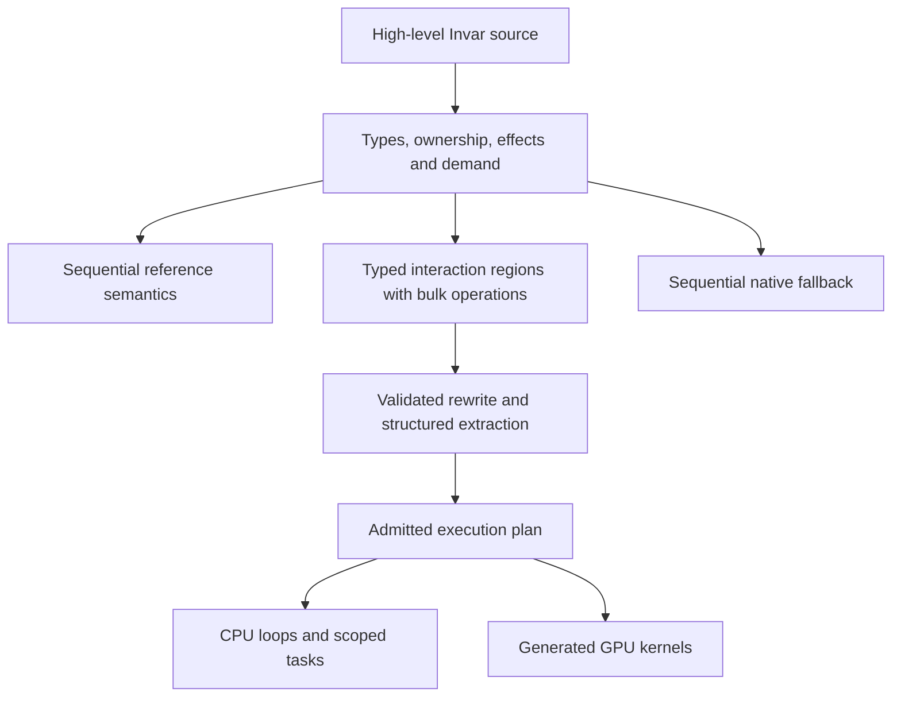

# Interaction foundations and automatic GPU compilation

Design decision: 2026-09-22; M1 scope revised 2026-09-23. The three-agent
reference reducer and typed production graph are separate. M1 no longer
requires a source-to-three-agent encoding. This is an architecture and a list
of implementation obligations, not a performance guarantee.

## The intended user experience

An application author writes high-level Invar code and does not write CUDA, thread blocks, or custom GPU kernels for the supported compute fragment. The compiler discovers or retains independent work, generates target code, and manages placement, memory, and completion. Small computations and unsupported regions still have correct sequential execution.

GPU execution and interaction combinators are different concepts. A compiler can generate GPU code from structured array operations without interaction nets. Conversely, an interaction-net encoding does not by itself guarantee an efficient GPU implementation. Invar chooses interaction foundations because they can give a common model for computation, sharing, and local rewriting; this is a project design commitment, not a theorem that every GPU compiler needs them.

“No kernels for users to write” is the goal. The compiler still generates device programs and contains reusable lowering/scheduling algorithms. Initial backends do not require users to supply a different handwritten kernel for every application. A universal dynamic reducer, if eventually added, still has an implementation and machine-level costs.

## Required core; selective physical execution

Invar's automatic-parallelization architecture must include:

1. A genuine minimal interaction-combinator reference calculus, with explicit ports, agents, active pairs, and rewrite rules. Source-to-minimal-calculus encoding is a separate research milestone, not an M1 acceptance claim.
2. A typed, demand-aware interaction representation that preserves ownership and carries structured bulk operations. It is an extension with separate semantic obligations, not literally the minimal calculus with renamed nodes.
3. Extraction from that representation into structured loops/tasks/kernels, with source provenance and admission evidence retained.
4. Differential tests and rewrite-law checks relating reference source, interaction execution, and extracted execution for the supported fragment.

The production automatic-parallelization route, including GPU candidates, must pass through the typed interaction region contract and validated extraction. This must be an actual typed connectivity representation with checked rules, not an unused graph attached to a conventional optimizer. Simple scalar functions and unsupported/effectful regions can remain ordinary sequential control flow. That fallback is part of the semantics-preserving design, not permission to delete the required interaction subsystem.

It is not necessary to expand each array element into several primitive graph agents. Keep `Map`, `Fold`, `Reduce`, `Scan`, and indexed regions as structured operations with reference definitions and lowering laws. Each bulk operation must define its normative meaning for every supported finite input and state the rule connecting it to its expansion. Bounded expansion and differential cases validate the trusted rule implementation; they do not prove the correspondence for all lengths. Merely wrapping arbitrary code in an opaque node does not establish an interaction semantics.



The diagram describes the target architecture. M0 implements the
source/reference/checker portion; M1 adds native CPU and finite interaction
foundations. Neither milestone is a completed parallel compiler.

## The mathematical layers

### 1. Resource-aware source judgment

Use a judgment of the form `Γ; Π ⊢ e : τ ! ε ▷ Π'`, where `Π` records incoming affine ownership and borrow permissions and `Π'` records permissions on normal completion. Terminal traps have no continuing permission state. `ε` references the canonical read/write, ordered-effect, failure, cleanup, demand, and termination summaries separately. This describes Invar semantics, not the Rust compiler's host borrow checker.

Affine access prevents arbitrary duplication of owners. Duplicating a copyable scalar or splitting read permissions does not allow duplicating a mutable array owner. Unknown footprints or failure properties are conservative facts.

### 2. Interaction connectivity and admissible rewrites

For a typed net `N`, each port has at most one connection, agents have explicit principal/auxiliary ports, and an active pair is defined by the chosen calculus. A rewrite preserves the external typed boundary and is permitted only under its demand, resource, effect, and numeric conditions.

The target local obligation is:

```text
well_typed(N, C) and admitted_rule(N -> N', premises)
    implies well_typed(N', C) and observations(N) = observations(N')
```

For the supported typed source encoding, compare demanded events and outcomes
with the independent source evaluator. Preserve unselected branches, traps,
effect prefixes, and resource outcomes. Correspondence to the minimal
combinator calculus is unproved and deferred. Confluence of that pure calculus
does not establish termination or correctness of this typed extension.

Freeze the typed connection rules, source encoding, activation discipline,
bulk-node meanings, and extraction relation before admitting transformations.
`typed-interaction-v1.md` records the finite M1 rules; later bulk families
need separate versioned contracts. Typing annotations alone supply no proof.

### 3. Dependence and permission reasoning

For candidate iterations `i != j`, a sufficient ordinary-memory condition is:

```text
W(i) intersect (R(j) union W(j)) = empty
W(j) intersect (R(i) union W(i)) = empty
```

Additionally establish safe storage lifetimes, demanded computation, termination/nontrapping behavior for initial rules, and absence of observable ordering conflicts. Logical independence must survive physical packing and vector/device accesses. The conditions are sufficient and conservative, not a complete decision procedure for all source programs.

Affine index reasoning can establish many regular-loop cases; trusted operation laws establish others. An input-dependent guard may protect a property only while the relevant inputs remain stable. An unknown result keeps sequential execution.

### 4. Algebraic bulk transformations

Use a small reusable algebra rather than a list of application-specific kernels:

- `map(f, xs)`: independent pointwise computation when `f` is eligible.
- `fold(f, z, xs)`: fixed sequential order; no regrouping permission.
- `reduce(op, identity, xs)`: regroup only under an established associative law; arbitrary permutation additionally requires commutativity.
- `scan`: lawful prefix composition; permits some recurrences to become parallel prefix algorithms.
- Stable selection: predicate flags, prefix positions, and nonconflicting output placement with preserved element order.

For instance, maps may fuse as `map(f, map(g, xs)) = map(f composed_with g, xs)` only under compatible footprints and appropriate totality/failure/effect conditions. A checked signed sum cannot silently use the modular-addition law. Laws carry semantic identity and explicit trust/evidence; tests alone do not manufacture a witness.

### 5. Scheduling and target realization

After legality, choose work partitioning, tiling, storage, synchronization, and transfers. GPU eligibility includes supported values/operations, required numerical behavior, physical bounds, uniformity/barriers where applicable, completion lifetimes, and resource limits. Profitability includes transfer and dispatch costs.

For fixed work `W` and dependency span `S`, `max(W/p, S)` is an idealized lower bound with `p` workers, before communication. Rewriting may replace an algorithm and change its work/span, but representing the same dependency chain as a graph does not eliminate it. Memory bandwidth, allocation, irregular work distribution, and device occupancy still matter.

## Concrete example

Given independent input arrays with equal lengths, a loop assigning `out[i] = wrapping_add(wrapping_mul(a[i], 3u32), b[i])` to a fresh output has useful structure: fixed domain, disjoint output indices, read-only inputs, total modular arithmetic, and no external effects.

The frontend establishes those facts; the typed interaction representation retains sharing and demand; extraction yields a bulk map; the backend generates a CPU loop or GPU kernel and its launch/transfer plan. No application-specific CUDA is required. For unknown indirect indices, a trapping callback, or loop-carried state, the compiler needs an additional applicable law/proof or keeps a serial implementation.

This is more powerful than merely scheduling prewritten kernels. It is also narrower than promising that every arbitrary sequential program becomes a fast parallel program. The language must make common lawful structure expressible and preserve it through lowering; supported ordinary-loop recognition extends that structure without requiring users to write parallel primitives everywhere.

## Required acceptance gates

- M1: freeze the reference reducer and typed graph separately; test typed
  source demand, affine ownership, real connectivity, beta/map rewrites,
  extraction, and native MIR differential execution. Do not claim primitive
  source encoding or automatic map recognition.
- M2: recognize the first wrapping map/reduction from ordinary source and
  route it through typed interaction representation/extraction. Compare with
  source and native serial execution and report ordinary-loop recognition
  separately from interaction-driven transformations. Reject illegal
  duplication, undemanded branch activation, stale evidence, and malformed
  ports.
- Before GPU acceptance: demonstrate generated device code, device completion/lifetime safety, and transfer-inclusive results for supported source.
- Compare against a direct structured path as an experimental control. If interaction processing is expensive, improve representation, fuse bulk regions, or change lowering. Removing the subsystem changes the accepted architecture and requires an explicit design decision; an ablation flag is not its production status.
- A mandatory runtime graph reducer is not assumed. Generic GPU reduction is a separate backend choice with its own memory/reclamation and performance evidence.

## Existing systems and limits of the analogy

[Futhark](https://futhark-lang.org/) demonstrates high-level functional array programs compiled to GPU code. Its [parallelism guide](https://futhark-lang.org/examples/basic-parallelism.html) explicitly distinguishes using parallel combinators from automatically discovering arbitrary independent subexpressions. It supports the feasibility of kernel-free application authoring, not a claim that all sequential code can be automatically parallelized.

[HVM2](https://github.com/HigherOrderCO/HVM2) is an interaction-combinator evaluator with GPU execution and code-generation paths. It illustrates a different route, including the reality that a graph evaluator/runtime and target code still need implementation. Its advertised speedups are not Invar benchmarks.

Do not conflate that historical HVM2 design with current Bend 2: the [current Bend repository](https://github.com/bendlang/bend) explicitly says Bend 1 programs and HVM do not carry over, and lists balanced-call restrictions on parallelism. These primary sources were checked on 2026-09-22; implementation research should pin revisions rather than treat moving README claims as a specification.

The theoretical starting point is [Lafont's interaction-combinator work](https://www.i2m.univ-amu.fr/perso/yves.lafont/publications.html). Invar's combined affine/effectful/structured system needs its own defined semantics and evidence; naming those ingredients does not establish a new theorem.
